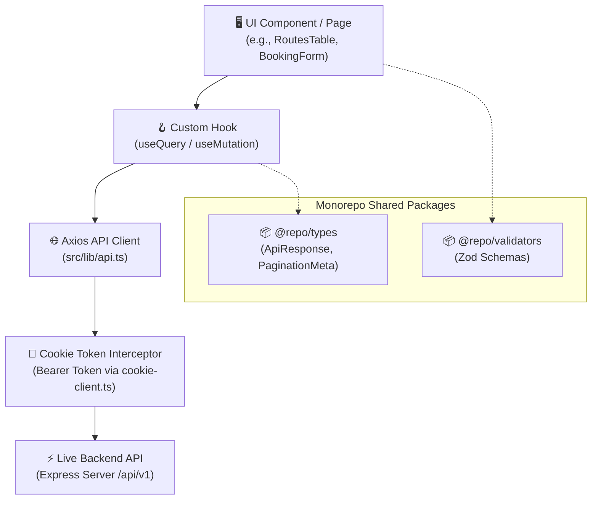

# 🚢 IslandHop — API Integration Architecture & Workflow

> **Standard Operating Procedure (SOP) for API Integration**  
> **Project:** IslandHop Monorepo (`apps/web` Next.js 16 + React 19 / `apps/api` Express)  
> **Stack:** TypeScript, Axios Interceptors, TanStack Query (React Query v5), Zod, React Hook Form, Sonner

---

## 📑 Table of Contents
1. [Architecture Overview](#1-architecture-overview)
2. [Project File Map for API Layer](#2-project-file-map-for-api-layer)
3. [Step-by-Step API Integration Workflow](#3-step-by-step-api-integration-workflow)
   - [Step 1: Define Contracts (Types & Zod Schemas)](#step-1-define-contracts-types--zod-schemas)
   - [Step 2: Define Query Key Factories](#step-2-define-query-key-factories)
   - [Step 3: Build Custom Query & Mutation Hooks](#step-3-build-custom-query--mutation-hooks)
   - [Step 4: Connect Hook in UI Component / Forms](#step-4-connect-hook-in-ui-component--forms)
   - [Step 5: Cache Invalidation & Synchronization](#step-5-cache-invalidation--synchronization)
4. [⚠️ Mandatory Rule: Complete Removal of Fake / Mock Data](#4-mandatory-rule-complete-removal-of-fake--mock-data)
5. [⚡ Advanced Pattern: Optimistic Updates](#5-advanced-pattern-optimistic-updates)
6. [📋 Best Practices & Standards (Do's & Don'ts Table)](#6-best-practices--standards-dos--donts-table)

---

## 1. Architecture Overview

All client-side API requests flow through a unified, type-safe pipeline:



### Key Architectural Pillars
- **Zero Raw Axios Calls in UI:** Components must never call `axios` or `fetch` directly. Every request is mediated by a custom hook.
- **Single Source of Truth:** Shared response contracts live in `@repo/types` and `@repo/validators`.
- **Automatic Auth:** Access tokens stored via `cookie-client.ts` are automatically injected into headers via Axios interceptors.
- **Cache-First UX:** React Query handles background revalidation, stale-time caching, window focus refetching, and pagination.

---

## 2. Project File Map for API Layer

| File / Directory | Purpose |
| :--- | :--- |
| [`packages/types/src/index.ts`](file:///c:/office-project/IslandHop/packages/types/src/index.ts) | Shared contracts (`ApiResponse<T>`, `PaginationMeta`, `ApiErrorResponse`) |
| [`packages/validators/src/index.ts`](file:///c:/office-project/IslandHop/packages/validators/src/index.ts) | Shared Zod schemas (Authentication, Pagination, Common Inputs) |
| [`apps/web/src/lib/api.ts`](file:///c:/office-project/IslandHop/apps/web/src/lib/api.ts) | Axios client, interceptors, error normalizer, and `get`, `post`, `patch`, `del` helpers |
| [`apps/web/src/lib/cookie-client.ts`](file:///c:/office-project/IslandHop/apps/web/src/lib/cookie-client.ts) | Client-side cookie getter/setter for auth tokens (`accessToken`) |
| [`apps/web/src/lib/query-client.ts`](file:///c:/office-project/IslandHop/apps/web/src/lib/query-client.ts) | Global TanStack Query client configuration |
| [`apps/web/src/hooks/use-*.ts`](file:///c:/office-project/IslandHop/apps/web/src/hooks/) | Feature-level React Query hooks (`use-auth.ts`, `use-routes.ts`, etc.) |

---

## 3. Step-by-Step API Integration Workflow

Whenever creating or integrating an endpoint (e.g., **Operator Routes**, **Bookings**, **Ferries**), execute the following 5 steps:

```
[ Step 1: Types & Schemas ] ➔ [ Step 2: Query Keys ] ➔ [ Step 3: Custom Hooks ] ➔ [ Step 4: UI Integration ] ➔ [ Step 5: Cache Sync ]
```

---

### Step 1: Define Contracts (Types & Zod Schemas)

Define the data models and request payloads.

```typescript
// apps/web/src/types/route.ts
import type { ApiResponse, PaginationMeta } from "@repo/types";

export interface IRoute {
  id: string;
  operatorId: string;
  originIsland: string;
  destinationIsland: string;
  departureTime: string;
  durationMinutes: number;
  basePrice: number;
  status: "ACTIVE" | "INACTIVE" | "MAINTENANCE";
  createdAt: string;
}

export interface CreateRoutePayload {
  originIsland: string;
  destinationIsland: string;
  departureTime: string;
  durationMinutes: number;
  basePrice: number;
}

export interface RouteFilterParams {
  page?: number;
  limit?: number;
  origin?: string;
  destination?: string;
  status?: string;
}
```

Define input validation using Zod:

```typescript
// apps/web/src/schemas/route.schema.ts
import { z } from "zod";

export const createRouteSchema = z.object({
  originIsland: z.string().min(1, "Origin island is required"),
  destinationIsland: z.string().min(1, "Destination island is required"),
  departureTime: z.string().min(1, "Departure time is required"),
  durationMinutes: z.coerce.number().positive("Duration must be greater than 0"),
  basePrice: z.coerce.number().positive("Price must be positive")
});

export type CreateRouteInput = z.infer<typeof createRouteSchema>;
```

---

### Step 2: Define Query Key Factories

Always construct query keys systematically using the **Query Key Factory Pattern** to prevent cache mismatch bugs:

```typescript
// Inside apps/web/src/hooks/use-routes.ts
import type { RouteFilterParams } from "@/types/route";

export const routeKeys = {
  all: ["routes"] as const,
  lists: () => [...routeKeys.all, "list"] as const,
  list: (params?: RouteFilterParams) => [...routeKeys.lists(), params] as const,
  details: () => [...routeKeys.all, "detail"] as const,
  detail: (id: string) => [...routeKeys.details(), id] as const
};
```

---

### Step 3: Build Custom Query & Mutation Hooks

Create the feature hook in `apps/web/src/hooks/use-routes.ts`:

```typescript
// apps/web/src/hooks/use-routes.ts
import { useQuery, useMutation, useQueryClient } from "@tanstack/react-query";
import { toast } from "sonner";
import type { ApiResponse } from "@repo/types";
import { get, post, patch, del } from "@/lib/api";
import type { IRoute, CreateRoutePayload, RouteFilterParams } from "@/types/route";

// 1. Query: Fetching paginated/filtered list
export function useRoutesQuery(params?: RouteFilterParams) {
  return useQuery({
    queryKey: routeKeys.list(params),
    queryFn: async ({ signal }) => {
      const response = await get<ApiResponse<IRoute[]>>("/routes", {
        params,
        signal // Enables automatic request cancellation on unmount
      });
      return {
        routes: response.data ?? [],
        meta: response.meta
      };
    },
    staleTime: 1000 * 60 * 3, // Fresh for 3 minutes
    placeholderData: (previousData) => previousData // Prevents layout flicker during pagination
  });
}

// 2. Query: Fetching single entity details
export function useRouteDetailQuery(routeId: string, enabled = true) {
  return useQuery({
    queryKey: routeKeys.detail(routeId),
    queryFn: async ({ signal }) => {
      const response = await get<ApiResponse<IRoute>>(`/routes/${routeId}`, { signal });
      return response.data;
    },
    enabled: Boolean(routeId) && enabled,
    staleTime: 1000 * 60 * 5
  });
}

// 3. Mutation: Creating a new route
export function useCreateRouteMutation() {
  const queryClient = useQueryClient();

  return useMutation({
    mutationFn: async (payload: CreateRoutePayload) => {
      return await post<ApiResponse<IRoute>>("/routes", payload);
    },
    onSuccess: (response) => {
      // Automatically refresh route tables
      queryClient.invalidateQueries({ queryKey: routeKeys.lists() });
      toast.success(response.message || "Route created successfully!");
    },
    onError: (error: Error) => {
      toast.error(error.message || "Failed to create route");
    }
  });
}

// 4. Mutation: Deleting a route
export function useDeleteRouteMutation() {
  const queryClient = useQueryClient();

  return useMutation({
    mutationFn: async (routeId: string) => {
      return await del<ApiResponse<null>>(`/routes/${routeId}`);
    },
    onSuccess: (response) => {
      queryClient.invalidateQueries({ queryKey: routeKeys.lists() });
      toast.success(response.message || "Route deleted successfully!");
    },
    onError: (error: Error) => {
      toast.error(error.message || "Failed to delete route");
    }
  });
}
```

---

### Step 4: Connect Hook in UI Component / Forms

#### Table or List Rendering
```tsx
"use client";

import { useState } from "react";
import { useRoutesQuery, useDeleteRouteMutation } from "@/hooks/use-routes";

export function RoutesTable() {
  const [page, setPage] = useState(1);
  const { data, isLoading, isError, error } = useRoutesQuery({ page, limit: 10 });
  const { mutate: deleteRoute, isPending: isDeleting } = useDeleteRouteMutation();

  if (isLoading) {
    return <div className="p-8 text-center animate-pulse">Loading routes from server...</div>;
  }

  if (isError) {
    return <div className="p-4 text-red-600 bg-red-50 rounded">Error: {error?.message}</div>;
  }

  if (!data?.routes.length) {
    return <div className="p-8 text-center text-muted-foreground">No routes found. Create one to get started!</div>;
  }

  return (
    <div className="space-y-4">
      {data.routes.map((route) => (
        <div key={route.id} className="flex items-center justify-between p-4 border rounded-lg">
          <div>
            <h4 className="font-semibold">{route.originIsland} ➔ {route.destinationIsland}</h4>
            <p className="text-sm text-muted-foreground">${route.basePrice} | {route.durationMinutes} mins</p>
          </div>
          <button 
            onClick={() => deleteRoute(route.id)} 
            disabled={isDeleting}
            className="px-3 py-1 text-sm text-red-600 hover:bg-red-50 rounded border border-red-200"
          >
            {isDeleting ? "Deleting..." : "Delete"}
          </button>
        </div>
      ))}
    </div>
  );
}
```

#### Form Submission with Validation
```tsx
"use client";

import { useForm } from "react-hook-form";
import { zodResolver } from "@hookform/resolvers/zod";
import { createRouteSchema, type CreateRouteInput } from "@/schemas/route.schema";
import { useCreateRouteMutation } from "@/hooks/use-routes";

export function CreateRouteForm({ onComplete }: { onComplete?: () => void }) {
  const { mutate: createRoute, isPending } = useCreateRouteMutation();

  const form = useForm<CreateRouteInput>({
    resolver: zodResolver(createRouteSchema),
    defaultValues: {
      originIsland: "",
      destinationIsland: "",
      departureTime: "",
      durationMinutes: 60,
      basePrice: 50
    }
  });

  const onSubmit = (values: CreateRouteInput) => {
    createRoute(values, {
      onSuccess: () => {
        form.reset();
        onComplete?.();
      }
    });
  };

  return (
    <form onSubmit={form.handleSubmit(onSubmit)} className="space-y-4">
      <div>
        <label className="text-sm font-medium">Origin Island</label>
        <input {...form.register("originIsland")} className="w-full p-2 border rounded" />
        {form.formState.errors.originIsland && (
          <p className="text-xs text-red-500">{form.formState.errors.originIsland.message}</p>
        )}
      </div>

      <button type="submit" disabled={isPending} className="px-4 py-2 text-white bg-blue-600 rounded">
        {isPending ? "Saving..." : "Save Route"}
      </button>
    </form>
  );
}
```

---

### Step 5: Cache Invalidation & Synchronization

When performing any mutation (`create`, `update`, `delete`, `toggleStatus`):
1. **Invalidate specific key branches:** `queryClient.invalidateQueries({ queryKey: routeKeys.lists() })`
2. **Invalidate details if edited:** `queryClient.invalidateQueries({ queryKey: routeKeys.detail(id) })`
3. React Query will automatically refetch active queries in the background and update the UI seamlessly.

---

## 4. ⚠️ Mandatory Rule: Complete Removal of Fake / Mock Data

> [!IMPORTANT]
> **API ইন্টিগ্রেশনের সময় সব ধরনের ফেক/মক ডেটা (Fake/Mock Data) সম্পূর্ণ রিমুভ করে ব্যাকএন্ডের রিয়েল ডেটা (Real Data) ব্যবহার করতে হবে।**  
> কোনো পেজ বা কম্পোনেন্টে হার্ডকোডেড ডামি ডেটা রেখে ইন্টিগ্রেশন শেষ বলে গণ্য করা যাবে না।

### 🛠️ Step-by-Step Cleanup Checklist

```
┌────────────────────────────────────────────────────────────────────────┐
│               MOCK DATA REMOVAL & PRODUCTION CHECKLIST                 │
├────────────────────────────────────────────────────────────────────────┤
│ [ ] 1. Disable Mock API Flag in apps/web/src/lib/api.ts                │
│        Set: export const USE_MOCK_API = false                          │
│                                                                        │
│ [ ] 2. Eliminate all imports from @/data/* in pages and components    │
│        (e.g., delete imports from routes.ts, bookings.ts, etc.)        │
│                                                                        │
│ [ ] 3. Replace static dummy arrays with custom hook data               │
│        (e.g., const { data } = useRoutesQuery())                       │
│                                                                        │
│ [ ] 4. Implement true Loading Skeleton states (not static defaults)   │
│                                                                        │
│ [ ] 5. Implement Empty State UI when backend returns empty array []   │
│                                                                        │
│ [ ] 6. Clean up unused mock functions from src/lib/mock-api.ts         │
└────────────────────────────────────────────────────────────────────────┘
```

---

## 5. ⚡ Advanced Pattern: Optimistic Updates

For instant UI feedback on actions like toggle switches or status changes:

```typescript
export function useToggleRouteStatusMutation() {
  const queryClient = useQueryClient();

  return useMutation({
    mutationFn: async ({ id, status }: { id: string; status: "ACTIVE" | "INACTIVE" }) => {
      return await patch<ApiResponse<IRoute>>(`/routes/${id}/status`, { status });
    },
    onMutate: async ({ id, status }) => {
      // 1. Cancel in-flight queries so they don't overwrite optimistic update
      await queryClient.cancelQueries({ queryKey: routeKeys.all });

      // 2. Snapshot current state for rollback
      const previousData = queryClient.getQueryData(routeKeys.lists());

      // 3. Update cache immediately before server responds
      queryClient.setQueriesData({ queryKey: routeKeys.lists() }, (old: any) => {
        if (!old?.routes) return old;
        return {
          ...old,
          routes: old.routes.map((route: IRoute) => 
            route.id === id ? { ...route, status } : route
          )
        };
      });

      return { previousData };
    },
    onError: (err, variables, context) => {
      // Rollback to previous state on failure
      if (context?.previousData) {
        queryClient.setQueryData(routeKeys.lists(), context.previousData);
      }
      toast.error("Failed to update route status. Reverted.");
    },
    onSettled: () => {
      // Re-fetch in background to sync with server truth
      queryClient.invalidateQueries({ queryKey: routeKeys.lists() });
    }
  });
}
```

---

## 6. 📋 Best Practices & Standards (Do's & Don'ts Table)

The table below outlines mandatory coding standards for all developers working on API integrations:

| Area / Scope | Do's ✅ (Best Practice) | Don'ts ❌ (Strictly Prohibited) | Why It Matters |
| :--- | :--- | :--- | :--- |
| **Data Source** | **Use Real Backend Data exclusively** via API endpoints once integrated. | **Do NOT retain fake/mock static data** or local dummy objects in production pages. | Eliminates fake UI states, outdated figures, and phantom IDs. |
| **API Mode** | **Set `USE_MOCK_API = false`** in `src/lib/api.ts` during live integration. | **Do NOT mix mock fallback logic** with live endpoint responses. | Guarantees test results match the actual server contracts. |
| **Call Site** | **Wrap all requests inside custom hooks** (`useQuery` / `useMutation`) in `src/hooks/`. | **Do NOT call `axios` or `fetch` directly** inside React components. | Ensures component reusability, testability, and clean separation of concerns. |
| **Cache Keys** | **Use Query Key Factory objects** (`routeKeys.list(params)`). | **Do NOT write loose, inline key arrays** like `["routes"]` or `["detail", 1]`. | Prevents cache collision bugs, typos, and incomplete invalidations. |
| **Data Sync** | **Invalidate matching query keys** on mutation success via `queryClient.invalidateQueries()`. | **Do NOT use `window.location.reload()`** or manual state hacking to refresh data. | Preserves client state, prevents page reloads, and ensures smooth UX. |
| **Network Lifecycle** | **Forward the `signal` parameter** from query functions to `get()` / `post()`. | **Do NOT ignore request cancellation** on component unmount. | Stops memory leaks, zombie requests, and race conditions on fast route switching. |
| **Forms & Validation** | **Validate inputs with Zod (`zodResolver`)** and typed payloads from `@repo/validators`. | **Do NOT send unvalidated `any` or raw objects** directly to the API. | Prevents bad payloads from reaching the server, catches schema mismatches early. |
| **Error Feedback** | **Handle user notifications centrally** using `toast.error()` in `onError` or interceptors. | **Do NOT clutter UI files** with repetitive, manual `try...catch` boilerplate. | Maintains consistent UI notification behavior across the entire app. |
| **Auth & Security** | **Store tokens in cookies** via `cookie-client.ts` (`accessToken`). | **Do NOT store auth tokens in `localStorage`**. | Enables seamless SSR / middleware authentication and prevents XSS token theft. |
| **State Handling** | **Render distinct Skeleton Loaders** and empty state views (`data.length === 0`). | **Do NOT leave screens blank** or show raw errors during network latency. | Provides immediate visual feedback and a polished, premium experience. |
